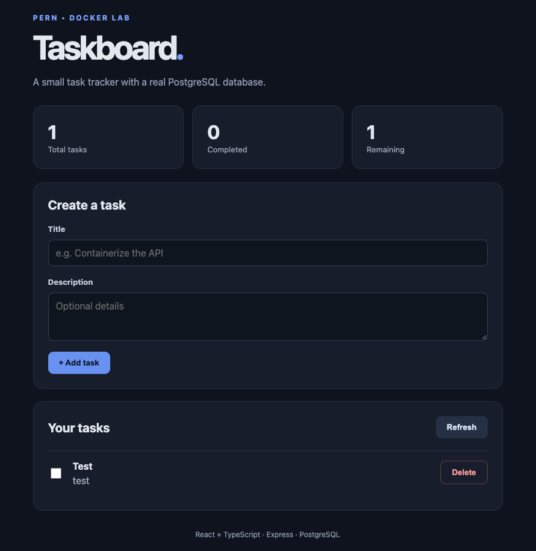

# Docker Lab Submission — Full-Stack PERN Taskboard

## 1. How to Run the Application

1. **Create the local environment file** from the template in the project root:
   ```bash
   cp .env.example .env
   ```
   *(Optionally customize `DB_PASSWORD` in `.env`. Note that `DB_HOST=database` resolves to the PostgreSQL Compose service over the internal Docker network, while `VITE_API_URL=http://localhost:3000` stays `localhost` because API requests originate from the host browser.)*

2. **Build and start all three services in detached mode:**
   ```bash
   docker compose up --build -d
   ```

3. **Verify container status and API/database connectivity:**
   ```bash
   docker compose ps
   curl http://localhost:3000/health
   ```
   Expected health response:
   ```json
   {"status":"ok","database":"connected"}
   ```

4. **Open the application in the browser:**
   - **Frontend UI:** `http://localhost:5173`
   - **Backend API:** `http://localhost:3000`



---

## 2. Design Notes (Part 1)

- **Why `COPY package*.json ./` comes before `COPY . .`:** Docker caches each `Dockerfile` instruction as an immutable layer. Because source code changes far more frequently than `package.json`, copying manifests and running `npm install` first allows Docker to reuse the cached dependency layer whenever only application code changes, dramatically speeding up rebuilds.
- **What `EXPOSE` does:** `EXPOSE 3000` and `EXPOSE 5173` serve as image metadata documenting which internal port each container listens on. `EXPOSE` does **not** publish a port to the host machine—actual host port publishing happens via `ports:` in `compose.yaml` (or `-p` in `docker run`).

---

## 3. Database Persistence Verification (Part 5)

### Verification Steps Performed
1. Started the stack with `docker compose up --build -d` and opened `http://localhost:5173`.
2. Created tasks, toggled completion status, and deleted a task through the Taskboard UI, verifying rows in PostgreSQL.
3. Ran `docker compose down` to stop and completely remove the `frontend`, `backend`, and `database` containers and Compose network.
4. Ran `docker compose up -d` to recreate fresh containers.
5. Refreshed `http://localhost:5173` and ran `docker compose exec database psql -U postgres -d taskboard -c "SELECT * FROM tasks;"` — confirmed all previously created task records remained intact.

### Volume Inspection
Identified and inspected the named volume using:
```bash
docker volume ls
docker volume inspect docker-challenge_postgres_data
```
Key output from `docker volume inspect`:
- **Volume Name:** `docker-challenge_postgres_data`
- **Driver:** `local`
- **Mountpoint (inside Docker Linux VM):** `/var/lib/docker/volumes/docker-challenge_postgres_data/_data`
- **Container Mount Target:** `/var/lib/postgresql/data`

### Why Named Volumes Preserve Data Across Container Recreation
A container's writable layer is ephemeral—when `docker compose down` removes the `database` container, anything written to its internal filesystem is destroyed. By mounting the named volume `postgres_data` at `/var/lib/postgresql/data`, PostgreSQL writes all table and WAL files to Docker-managed storage outside the container's lifecycle. When `docker compose up -d` creates a brand-new `postgres:17` container, Docker reattaches `docker-challenge_postgres_data` to `/var/lib/postgresql/data`, so PostgreSQL immediately loads the existing `taskboard` database and `tasks` rows. *(Running `docker compose down -v` would explicitly delete named volumes and wipe the data, so `-v` is omitted.)*

---

## 4. Docker Command Demonstration (Part 7)

| Task | Command Used |
|---|---|
| **1. Build all project images** | `docker compose build` |
| **2. Start all services in detached mode** | `docker compose up -d` |
| **3. List running containers** | `docker compose ps` *(or `docker ps`)* |
| **4. Follow only backend logs** | `docker compose logs -f backend` |
| **5. Open a shell in the backend container** | `docker compose exec backend sh` |
| **6. Run a SQL query from inside the PostgreSQL container** | `docker compose exec database psql -U postgres -d taskboard -c "SELECT * FROM tasks;"` |
| **7. Restart only the backend** | `docker compose restart backend` |
| **8. Rebuild only the frontend** | `docker compose build frontend` |
| **9. Stop and remove containers while preserving database records** | `docker compose down` |
| **10. List Docker images and identify unused ones** | `docker images` and `docker images -f "dangling=true"` *(or `docker system df -v` to see images with `CONTAINERS = 0`)* |

---

## 5. Troubleshooting Findings (Part 6)

### Scenario 1: Backend logs show `ECONNREFUSED` while connecting to PostgreSQL
- **How to diagnose:** Check whether the backend is trying to connect to `127.0.0.1:5432` (`localhost` inside the backend container refers to the backend container itself, not PostgreSQL), using the wrong hostname/port, or starting before PostgreSQL has finished initializing.
- **Commands to run:**
  ```bash
  docker compose logs backend
  docker compose ps
  docker compose config
  ```
- **Fix:** Set `DB_HOST=database` (matching the Compose service name) in `.env` and pass it under `backend.environment` in `compose.yaml`. Ensure `database` defines a `pg_isready` `healthcheck` and `backend` uses `depends_on` with `condition: service_healthy` so Express waits until PostgreSQL accepts connections.

### Scenario 2: React renders, but fetching tasks fails in the browser
- **How to diagnose:** Because React runs in the **host browser** rather than inside the Docker network, check whether the browser is trying to call an internal Docker hostname (such as `http://backend:3000`), whether backend port `3000` is unpublished on the host, or whether the backend service is unhealthy.
- **Commands to run:** Inspect failed requests in Browser DevTools (**Network** tab), then verify from the host terminal:
  ```bash
  docker compose ps
  curl http://localhost:3000/health
  ```
- **Fix:** Set `VITE_API_URL=http://localhost:3000` in `.env` / `compose.yaml`, ensure `backend` publishes `"3000:3000"` under `ports:`, and recreate the frontend (`docker compose up -d --build frontend`).

### Scenario 3: React code changes do not appear without rebuilding the image
- **How to diagnose:** `COPY . .` in `client/Dockerfile` copies source files into `/app` once at build time. Without a bind mount (or Compose watch), editing files on the host does not update `/app` inside the running container.
- **Commands to run:**
  ```bash
  docker compose config
  docker compose exec frontend cat /app/src/App.tsx
  ```
- **Fix:** Configure a bind mount for `./client:/app` in `compose.yaml` alongside an anonymous volume at `/app/node_modules` so the host folder does not overwrite the container's Linux `node_modules`:
  ```yaml
  volumes:
    - ./client:/app
    - /app/node_modules
  ```

### Scenario 4: The backend container exits immediately
- **How to diagnose:** Inspect the container exit code and logs. In `server/src/index.ts`, if `initializeDatabase()` throws (for example, mismatched `DB_USER` / `DB_PASSWORD` / `DB_NAME` vs. `POSTGRES_USER` / `POSTGRES_PASSWORD` / `POSTGRES_DB`, or missing environment variables), the startup catch handler logs the error and calls `process.exit(1)`. A typo in `CMD` or missing dependencies can also cause an immediate exit.
- **Commands to run:**
  ```bash
  docker compose ps -a
  docker compose logs backend
  ```
- **Fix:** Align the database credentials in `.env` and `compose.yaml` between `backend` and `database` (note: if changing Postgres credentials after a volume was already initialized, recreate the volume or update the Postgres role), verify `CMD ["npm", "run", "dev"]` in `server/Dockerfile`, and run `docker compose up -d`.

### Scenario 5: Host port `5432` is already in use by a local PostgreSQL installation
- **How to diagnose:** Docker fails to start the `database` container with a port bind conflict (`address already in use`) when `ports: - "5432:5432"` collides with a PostgreSQL instance already running on the host machine.
- **Commands to run:**
  ```bash
  nc -zv localhost 5432
  sudo lsof -i :5432
  ```
- **Fix:** Remove `ports:` from the `database` service in `compose.yaml` (since `backend` reaches PostgreSQL internally at `database:5432` over the Compose network without needing a published host port), **or** map an unused host port on the left side such as `"5433:5432"`.
